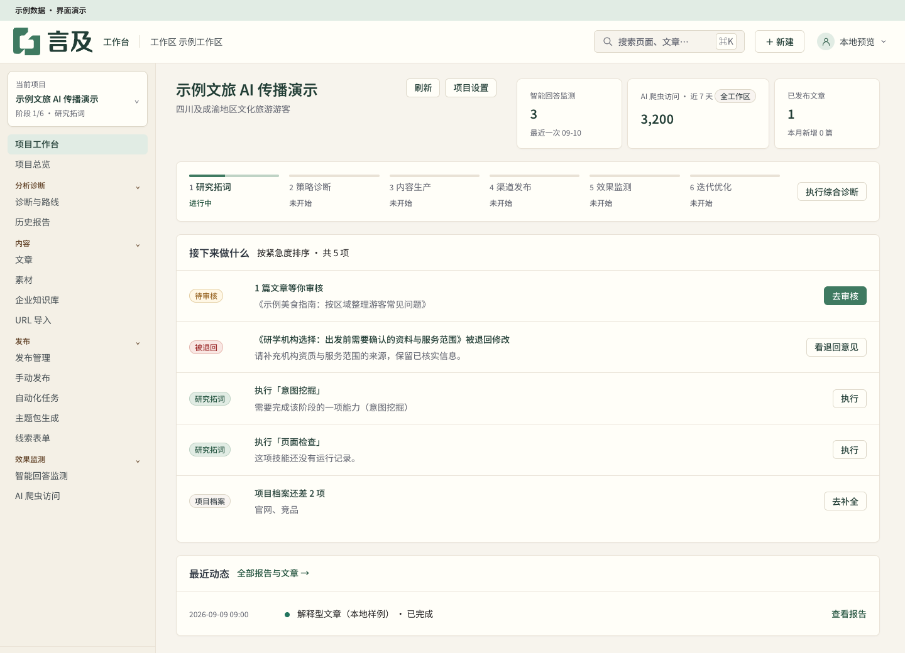
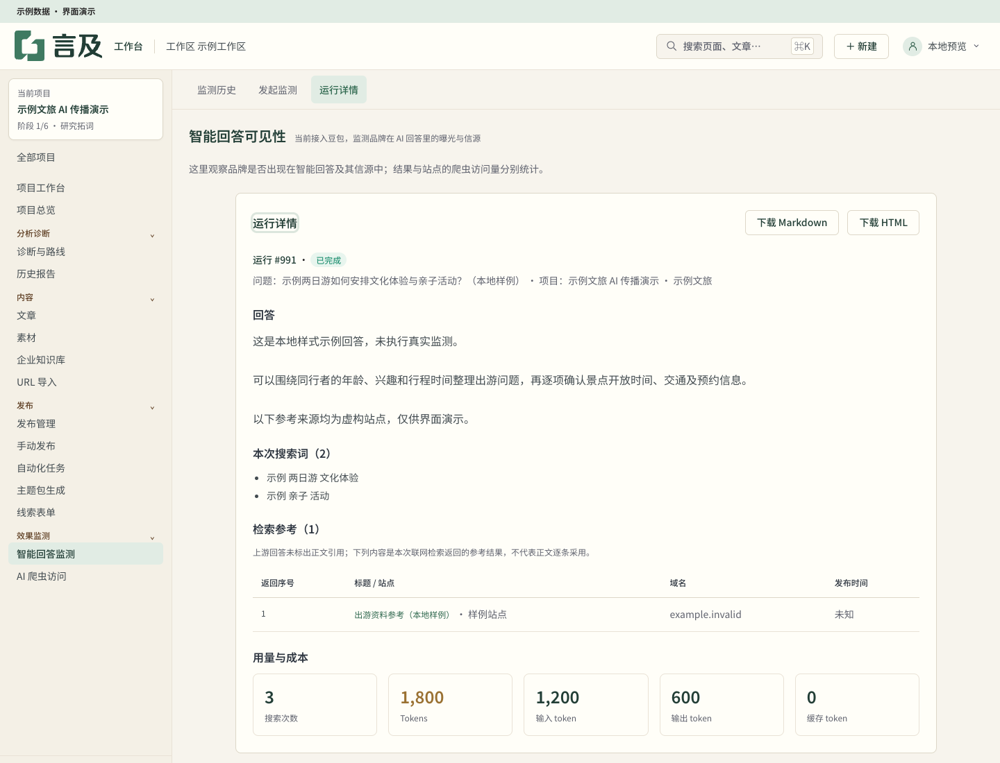

# Yanji GEO-SaaS (言及) — Open-Source Self-Hosted GEO (Generative Engine Optimization) Project Workbench

[简体中文](README.md) | **English** · Latest Release: [v0.1.3](https://github.com/Mellowing-Potato/Potato-GEO-SaaS/releases/tag/v0.1.3) · License: [Apache-2.0](LICENSE) · [No-Docker Portable Guide (ZH)](PORTABLE.md) · [Docker Guide (ZH)](INSTALL.md) · [FAQ](#frequently-asked-questions-faq)

> **v0.1.3 is published (seamless cross-version auto-upgrade, AI-agent daemon detachment & UI redesign).** Building on `v0.1.2` direct `http://127.0.0.1:8000` loopback access and pure 7-bit ASCII PowerShell bootstrapping, `v0.1.3` automatically backs up and upgrades existing older instances in place when re-running the standard installer on macOS / Windows / Linux, detaches background services cleanly from AI-agent subshells/Job Objects, and ships the stone-white & deep-pine palette, 3-step Day-1 onboarding, segmented model setup, readable URL import links, and Tremor-style analytics overview. See [Verified vs. Unverified](#verified-vs-unverified) and [CHANGELOG.md](CHANGELOG.md).

**Yanji GEO-SaaS (言及)** is an open-source, self-hosted **GEO (Generative Engine Optimization / AI Search Optimization) project management and content delivery workbench** built for GEO agencies, solo consultants, and brand marketing teams. Run it locally with **zero Docker on macOS Apple Silicon, Windows x64, and Linux**—or self-host via **Docker**—with **Bring Your Own Key (BYOK)**, strict per-account workspace isolation, a 1024-dimensional RAG knowledge base, 11 rendered GEO skills, a browser draft assistant, and **Doubao (Volcengine Ark) AI search visibility monitoring**.

> **Contents**: [Core Capabilities & 6-Stage GEO Workflow](#core-capabilities--6-stage-geo-workflow) · [Quick Install (v0.1.3)](#quick-install-v013) · [3-Minute Getting Started](#3-minute-getting-started) · [Screenshots](#screenshots) · [Capabilities & Boundaries](#capabilities--boundaries) · [Yanji vs. GEOFlow](#yanji-vs-geoflow) · [Channel Support](#channel-support) · [FAQ](#frequently-asked-questions-faq) · [Verified vs. Unverified](#verified-vs-unverified) · [License & Attribution](#license-attribution--branding)

---

## Core Capabilities & 6-Stage GEO Workflow

While classic SEO tools optimize for keyword rankings in traditional search engines, Yanji focuses on end-to-end **Generative Engine Optimization (GEO / AI SEO / LLM Visibility)** delivery across client projects:

- **No-Docker Portable Install + Docker Self-Hosting**: `v0.1.0` ships self-contained portable packages (custom AGPL-free FrankenPHP + PHP 8.5.13 + bundled Python 3.12.16 + open-source CJK fonts) for **macOS Apple Silicon**, **Windows 10/11 x64**, and **Linux (x86_64 / ARM64)**—startable in one command without Docker, PHP, or Python installed. Full Docker Compose deployment is retained alongside it.
- **Bring Your Own Key (BYOK) & Optional Local Magpie**: Configure text, vision, 1024-dim embedding, and Doubao web-search monitoring models independently per workspace with encrypted key storage. No paid tiers, no billing markup, and no centralized gateway. Unknown-outcome model calls are never auto-retried, preventing duplicate API spend.
- **Multi-Project Client Delivery & Workspace Isolation**: Each account owns a strictly isolated workspace supporting multiple client/brand projects. Platform administrators cannot read other users' workspaces, and private reports are protected by static HTTP 404 guardrails.
- **11 Verified GEO Skills & Multi-Format Report Rendering**: Integrates pinned [yao-geo-skills](https://github.com/yaojingang/yao-geo-skills) covering intent mining, brand GEO audits, execution roadmaps, structured content generation, and title optimization—with out-of-the-box Markdown, HTML, DOCX rendering (including WOFF2 font subsetting) and ReportLab PDF export for supported skills.
- **Doubao AI Search Visibility Monitoring**: Calls Volcengine Ark web-search-enabled models directly from your workspace, capturing real AI answers, search queries, returned reference sources, and token usage with report export.

### 6-Stage GEO Project Workflow

| Stage | Objective | Included Capabilities / Verified Bundled Skills |
| --- | --- | --- |
| 1. Intent Research | Organize brand facts and mine AI search user intents | Project materials, 1024-dim vector knowledge base, `yao-geo-intent-miner` |
| 2. Strategy & Audit | Assess brand GEO readiness and build an action plan | `yao-geo-panorama-audit`, `yao-geo-execution-roadmap`, `yao-geo-tracking` |
| 3. Content Production | Generate and refine structured content & reports for AI retrieval | `yao-geo-explainer-builder`, `yao-geo-ranking-article-builder`, `yao-geo-content-refiner`, `yao-geo-title-optimizer`, `yao-geo-page-blueprint`, `yao-geo-brand-graph`, `yao-geo-knowledge-base-builder` |
| 4. Channel Distribution | Separate drafts from verified public URLs | Instance-bound browser draft assistant (Zhihu plain-text drafts verified), publish records |
| 5. AI Visibility Monitoring | Track Doubao web-search answers, sources, and API usage | Volcengine Ark Doubao web-search monitoring, request/token/status ledger |
| 6. Iteration | Review failed outputs and refine content & knowledge assets | Failed-output retention, content refinement, task recovery |

### Who It Is For

- **GEO Agencies & Freelance Consultants**: Manage separate client brands, knowledge bases, deliverable reports, draft status, and visibility logs in one project workbench.
- **Brand Marketing & Content Teams**: Self-host an AI search optimization workbench so brand materials and API credentials stay on your own machine or infrastructure.
- **Privacy- and Cost-Conscious Teams**: Apache-2.0 open-source codebase with BYOK direct provider connections and zero SaaS lock-in.

---

## Quick Install (v0.1.3)

**v0.1.3 is released.** Platform packages, checksums, corresponding source/relink kits and Docker image details are on [GitHub Release v0.1.3](https://github.com/Mellowing-Potato/Potato-GEO-SaaS/releases/tag/v0.1.3). See [CHANGELOG.md](CHANGELOG.md).

### Option 1: One-Line No-Docker Portable Install (Recommended)

Requires no pre-installed Docker, PHP, or Python. The bootstrapper enforces HTTPS (including redirects), verifies the pinned `SHA256SUMS` digest (`eddbb3fc6961ae6660b92e326ad303bbe769c5a8f5afa3fb8bf2816c3d0e5fc5`) and every file inside the archive, and provides a local `yanji` / `yanji.cmd` CLI (`start`, `stop`, `status`, `doctor`, `backup`, `restore`, `upgrade`).

**macOS (Apple Silicon M1–M4) & Linux (x86_64 / ARM64):**

```sh
curl -fsSL https://github.com/Mellowing-Potato/Potato-GEO-SaaS/releases/download/v0.1.3/get-yanji.sh | sh
```

**Windows 10 / 11 (64-bit PowerShell 5.1+):**

```powershell
irm https://github.com/Mellowing-Potato/Potato-GEO-SaaS/releases/download/v0.1.3/get-yanji.ps1 | iex
```

> Installation displays download, integrity-check, initialization and service-start progress. Initial readiness may take about a minute. Fresh portable instances need no email or password; matching installed versions start immediately without re-downloading, and older installed versions automatically back up and upgrade in place. Once running, open `http://127.0.0.1:8000` directly in your local browser (configure `127.0.0.1` to bypass any local proxy), double-click the desktop shortcut, or run `yanji open`. See [PORTABLE.md](PORTABLE.md) for offline installs and operations. Intel Mac (`macos-x64`) requires Docker.

You can also download the matching platform archive from [GitHub Release v0.1.3](https://github.com/Mellowing-Potato/Potato-GEO-SaaS/releases/tag/v0.1.3) first, then follow the standard local installation steps in [PORTABLE.md](PORTABLE.md).

> **Portable access:** Single-user portable instances bind strictly to `127.0.0.1` and establish or reuse the owner session via same-origin loopback checks plus Cookie+Token binding. Existing account-based instances and explicit account credentials keep their original sign-in flow. The maintainer confirmed candidate installation, update, passwordless access, local Magpie service detection and model listing on Apple Silicon Mac. Magpie activation and real inference in this new flow remain untested.

### Option 2: Docker Self-Hosting

Best for server deployments, PostgreSQL + `pgvector`, or Intel Mac. Ensure Docker is running, then clone the repository and run the installer inside the project directory:

```bash
git clone https://github.com/Mellowing-Potato/Potato-GEO-SaaS.git yanji
cd yanji
bash scripts/install.sh
```

The script creates the initial admin interactively and starts `web`, `worker`, `scheduler` and `postgres` containers. See [INSTALL.md](INSTALL.md) and [v0.1.3 Release](https://github.com/Mellowing-Potato/Potato-GEO-SaaS/releases/tag/v0.1.3) for image, backup/restore, upgrade and proxy DNS guidance.

### Option 3: Install via an AI Assistant / One-Click Repo Entry

- **Delegate to any AI assistant (WorkBuddy, Claude Code, Cursor, etc.):** Simply paste the repository link:

```text
Install and start https://github.com/Mellowing-Potato/Potato-GEO-SaaS
```

> **Note for AI Agents:** When asked to install, start, or update Yanji, follow [AGENTS.md](AGENTS.md) and [docs/INSTALL-AGENT.md](docs/INSTALL-AGENT.md)—use the one-line no-Docker release installer above or run root `.\install.ps1` (Windows) / `sh install.sh` (macOS/Linux) without setting up Docker, PHP, or Node dev environments.

- **From a cloned repository:** Double-click `install.cmd` / run `.\install.ps1` on Windows, or run `sh install.sh` on macOS/Linux (pass `--docker` for Docker). Matching installed releases open immediately without re-downloading; older installed releases automatically back up and upgrade in place while preserving all projects, database records, and encrypted API keys.

---

## 3-Minute Getting Started

Portable installation opens the workbench automatically; while running, open `http://127.0.0.1:8000` directly in your local browser, or use the desktop shortcut / `yanji open` to start services and enter. Docker (default `http://localhost:8000`) and account-based instances still require the initial admin sign-in. Then configure:

1. **Configure a Text Model (Required)**: Enter your provider model name, Base URL and API Key, test and save. Alternatively, start local [Magpie](https://github.com/yetone/magpie), click “Connect local Magpie” in the single-user portable instance, choose a catalog model, save, and explicitly select it for text. Vision is configured separately and requires an image-capable model; direct provider settings are preserved.
2. **Configure Optional Models as Needed**:
   - **Knowledge Base (RAG)**: Configure a **1024-dimensional** embedding model.
   - **Image / Scanned PDF Recognition**: Configure an optional vision model.
   - **Doubao AI Visibility Monitoring**: Configure a Volcengine Ark model and API Key with web search (`web_search`) enabled in your Ark console.
3. **Create a Project & Import Brand Materials**: Create a client or brand project and import documents, plain text, or URLs into the knowledge base.
4. **Run GEO Skills & Review Outputs**: Execute skills across the 6-stage workbench, manually review outputs, download Markdown / HTML / DOCX / PDF reports, or sync drafts via the browser assistant.
5. **Monitor Doubao Visibility & Iterate**: Run web-search visibility queries, inspect answers, search terms, and citations, and refine content in the next iteration.

All model and search fees are billed directly by your chosen providers. Yanji stores keys encrypted per workspace and never fabricates mock results when a model is unconfigured.

---

## Screenshots

The screenshots below use **sample project data** to illustrate UI layout (not live customer data or paid-model inference proof):



<details>
<summary>Expand Doubao AI search visibility monitoring screenshot (sample data)</summary>



</details>

---

## Capabilities & Boundaries

| Module | Current Scope & Boundaries |
| --- | --- |
| Projects & Materials | Organize brand documents, knowledge items, articles, revisions, and assets per project |
| GEO Skills & Reports | Intent research, panorama audits, roadmaps, and content drafting; downloadable reports require human review |
| 1024-Dim Knowledge Base | Material ingestion, 1024-dim vector indexing, and retrieval; disabled unless an embedding model is configured |
| Doubao Visibility Monitoring | Direct Volcengine Ark web-search calls displaying answers and upstream references (references may not map 1:1 to inline citations) |
| Publish Management | Strictly distinguishes drafts, platform drafts, and verified public URLs; never marks an item "published" without a real public URL |
| Usage & Fault Tolerance | Tracks call counts, tokens, latency, and succeeded/failed/unknown states; unknown-outcome calls are never auto-retried |
| Analytics, Leads & Theme Packs | Retains analytics panels, lead forms, theme packs, and queue health entry points where project data/config exists |

- **Workspace Isolation**: Each account gets one private workspace and can manage multiple client projects inside it. **Neither agencies nor platform administrators can view other accounts' workspaces; shared multi-user workspaces are not provided.**
- **Embedding Model Lock**: Vector embeddings are keyed by `provider + model name`. Switching embedding models while materials are indexed is blocked (even between two 1024-dim models); delete existing indexed materials first (no one-click purge yet).
- **Output Quality Checks**: Model outputs are not guaranteed to pass quality checks. In testing, an explainer long-form draft that failed length/evidence checks was retained as failed rather than marked deliverable; title optimization passed and exported DOCX. Scores are model heuristics, not guarantees of CTR, rankings, or commercial outcomes.

---

## Yanji vs. GEOFlow

**Attribution**: Yanji ports and adapts selected code and capabilities from Yao Jingang's [GEOFlow](https://github.com/yaojingang/GEOFlow) and uses skills, methods, and report assets from [yao-geo-skills](https://github.com/yaojingang/yao-geo-skills). Thank you to Yao Jingang and upstream contributors.

- **Yanji GEO-SaaS** centers on **client project delivery**—organizing materials, 6-stage GEO workflows, skill reports, drafts, and visibility records per project, with no-Docker portable packages and an **Apache-2.0** license.
- **GEOFlow** focuses on **continuous corporate website and multi-site content operations**—combining multi-site publishing, managed sites, `llms.txt` / sitemap tooling, editorial task assignments, and team review workflows.

**Baseline**: Yanji source (2026-11-14, with Magpie and `v0.1.0` portable updates through 2026-11-24) compared against GEOFlow 3.2.1 pinned at commit [`6976eec`](https://github.com/yaojingang/GEOFlow/tree/6976eec849cc8be7829f15723c600b111552d99c). See [README.md](README.md#言及与-geoflow-的区别) for the full 22-row comparison table, [licenses/ported-files.json](licenses/ported-files.json), and [NOTICE](NOTICE) for file-level provenance. No comparative benchmark of performance, generation quality, or GEO effectiveness has been performed.

---

## Channel Support

| Channel | Implementation & Verification Scope |
| --- | --- |
| Zhihu Articles | Verified plain-text draft sync via instance-bound browser assistant; final publishing is performed manually by you |
| Weibo Articles | Plain-text draft adapter and automated tests implemented; real account verification and image transfer not yet verified |
| WordPress & HTTP Endpoints | Website channel interfaces implemented; real remote publishing not yet verified |
| WeChat Official Account | Layout export and draft API code present; real account binding and remote draft verification deferred |
| Xiaohongshu & Other Platforms | Account registry, publish tickets, and manual publish logging only (not automatic publishing) |

The browser extension is downloaded from your own instance, trusts only that configured origin, keeps cookies/passwords locally, and saves drafts without auto-publishing. See [browser-extension/README.md](browser-extension/README.md).

---

## Frequently Asked Questions (FAQ)

### 1. Is Yanji free and open source? Are there paid plans or API markups?
Yes. Yanji is licensed under [Apache-2.0](LICENSE) and fully self-hosted. It includes no paid plans, billing gates, or hosted proxy—you supply your own provider API keys (BYOK) and pay your chosen AI providers directly.

### 2. Do I need Docker to run Yanji? Which operating systems are supported?
No. Starting with `v0.1.0`, Yanji ships **no-Docker portable packages** for **macOS Apple Silicon (M1–M4)**, **Windows 10/11 x64**, **Linux x86_64**, and **Linux ARM64**, bundling standalone PHP 8.5.13, AGPL-free FrankenPHP, Python 3.12.16, and open-source report fonts. Docker Compose remains available for servers, PostgreSQL/`pgvector`, and **Intel Mac**.

### 3. Which AI models and search monitoring engines are supported?
Text, vision, and 1024-dim embedding models connect directly to compatible API providers; text and vision can also connect to local [Magpie](https://github.com/yetone/magpie). AI search visibility monitoring currently supports **Doubao** via Volcengine Ark web-search-enabled models.

### 4. Is client data isolated when running multiple GEO projects?
Yes. Each account operates inside a strictly isolated workspace; other users and platform administrators cannot view workspace data or encrypted API keys, and private report files are blocked from public static serving (HTTP 404).

### 5. Why does the browser assistant save drafts instead of auto-publishing?
To protect account security and editorial control: platform cookies remain inside your local browser, drafts are reviewed and published by you, and Yanji never records an article as "published" without a real public URL.

### 6. How does Yanji differ from traditional SEO software?
Traditional SEO tools target classic keyword rankings and backlinks. Yanji targets **Generative Engine Optimization (GEO)**—structuring brand knowledge, mining AI search intents, generating auditable evidence-backed content/reports, and monitoring real AI web-search answers and reference sources across a 6-stage project workflow.

---

## Verified vs. Unverified

- **Current v0.1.3 formal release (2026-11-27)**: Build source `a9d84db7ca30c3201bc9dd872d9b70f551972866`, unified `SHA256SUMS` digest `eddbb3fc6961ae6660b92e326ad303bbe769c5a8f5afa3fb8bf2816c3d0e5fc5`. All 12 jobs in [release workflow #45850087833](https://github.com/Mellowing-Potato/Potato-GEO-SaaS/actions/runs/45850087833) passed: dual-architecture tests/audits, four native portable packages and acceptance flows, dual-architecture Docker images, formal publication of 17 release assets, and standard public-entry checks on macOS and Windows ([Mac fresh](https://github.com/Mellowing-Potato/Potato-GEO-SaaS/actions/runs/45850087833/job/140034075059), [Mac interrupted](https://github.com/Mellowing-Potato/Potato-GEO-SaaS/actions/runs/45850087833/job/140034074992), [Windows fresh](https://github.com/Mellowing-Potato/Potato-GEO-SaaS/actions/runs/45850087833/job/140034075043), [Windows interrupted](https://github.com/Mellowing-Potato/Potato-GEO-SaaS/actions/runs/45850087833/job/140034074933)), alongside pure 7-bit ASCII `get-yanji.ps1` verification, cross-version auto-upgrade/rollback regressions, background daemon detachment, and UI/onboarding test suites. Public-entry CI checks do not replace manual desktop GUI verification, specific third-party agent UX verification, or live paid-model inference.

- **Historical v0.1.2 formal release (2026-11-26)**: Build source `20d57bc17f541a3064a7c61b9b65d453a939c9cc`, unified `SHA256SUMS` digest `a2e8d887efea5ad8e89c367613364b2039c34a51ce5dec720f59db8fd48984b9`. All 12 jobs in [release workflow #45768018488](https://github.com/Mellowing-Potato/Potato-GEO-SaaS/actions/runs/45768018488) passed: dual-architecture tests/audits, four native portable packages and acceptance flows, dual-architecture Docker images, formal publication of 17 release assets, and standard public-entry checks on macOS and Windows ([Mac fresh](https://github.com/Mellowing-Potato/Potato-GEO-SaaS/actions/runs/45768018488/job/139745468654), [Mac interrupted](https://github.com/Mellowing-Potato/Potato-GEO-SaaS/actions/runs/45768018488/job/139745468642), [Windows fresh](https://github.com/Mellowing-Potato/Potato-GEO-SaaS/actions/runs/45768018488/job/139745468597), [Windows interrupted](https://github.com/Mellowing-Potato/Potato-GEO-SaaS/actions/runs/45768018488/job/139745468596)), alongside pure 7-bit ASCII `get-yanji.ps1` verification and direct loopback same-origin session/anti-CSRF/proxy checks. Public-entry CI checks do not replace manual desktop GUI verification, specific third-party agent UX verification, or live paid-model inference.

- **Historical v0.1.1 same-version repair/reissue**: All 12 jobs in [release workflow #45737825566](https://github.com/Mellowing-Potato/Potato-GEO-SaaS/actions/runs/45737825566) passed: dual-architecture tests/audits, four native portable packages and acceptance flows, dual-architecture Docker images, formal asset publication, and the standard public commands on macOS and Windows ([Mac fresh](https://github.com/Mellowing-Potato/Potato-GEO-SaaS/actions/runs/45737825566/job/139649102537), [Mac interrupted](https://github.com/Mellowing-Potato/Potato-GEO-SaaS/actions/runs/45737825566/job/139649099554), [Windows fresh](https://github.com/Mellowing-Potato/Potato-GEO-SaaS/actions/runs/45737825566/job/139649101890), [Windows interrupted](https://github.com/Mellowing-Potato/Potato-GEO-SaaS/actions/runs/45737825566/job/139649100868)). Build source: `6f797567dd18833412f1a6e0ff4c139129106949`. Public-entry checks used default paths and port 8000, verified the build, read-only onboarding, passwordless cookie and protected workspace API, and rejected anonymous requests and tokens without cookie binding. These checks do not verify real GUI use, particular agent products, or real model inference. Earlier source/package Windows entry checks (two canonical and four registered `.lnk` cases each, including Unicode directories) remain documented in [native workflow #45665229256](https://github.com/Mellowing-Potato/Potato-GEO-SaaS/actions/runs/45665229256/job/139385482871).

- **Historical published v0.1.1 installer repair/reissue**: All 10 release jobs succeeded, covering tests and audits on both architectures, four-platform portable builds, Docker images, release assets and both Mac public-entry scenarios ([historical repair/reissue workflow #45594562303](https://github.com/Mellowing-Potato/Potato-GEO-SaaS/actions/runs/45594562303)). That Mac public entry was recorded separately: fresh install: Passed using the public standard `curl ... | sh` command, default paths and port 8000; services were ready, and the passwordless cookie, protected workspace API and rejection of anonymous/unbound tokens were verified ([job log](https://github.com/Mellowing-Potato/Potato-GEO-SaaS/actions/runs/45594562303/job/139153283994)); interrupted install: Passed using the public standard `curl ... | sh` command, default paths and port 8000; services were ready, and the passwordless cookie, protected workspace API and rejection of anonymous/unbound tokens were verified ([job log](https://github.com/Mellowing-Potato/Potato-GEO-SaaS/actions/runs/45594562303/job/139153284005)). Entry evidence covers the normal command, default paths and port, workbench cookie and protected API only; it is not complete GUI or real Magpie inference acceptance and does not verify the current repair preparation. If an older installation stopped before the account prompt, has not generated an instance key, and has an empty default database, the installer checks the original configuration and initialization/binding state before resuming local passwordless setup when eligible. Existing accounts and data are preserved. The eight successful jobs and local-package checks from the first v0.1.1 publication are historical records; they did not cover the reader-facing generated-bootstrap and HTTPS-download entry.

- **Historical first-publication v0.1.1 evidence**: The full local PHP suite ran 1,740 tests: 1,739 passed and one platform-specific test was skipped, with 13,032 assertions. The default `npm run test:js` suite passed. The maintainer confirmed Apple Silicon Mac candidate installation, update, passwordless access, local Magpie service detection and model listing. Formal four-platform release CI is separate evidence: All 8 jobs passed: dual-architecture suites and audits, four native portable builds and acceptance runs, dual-architecture images, and publication of all 17 release assets ([release workflow #45572085735](https://github.com/Mellowing-Potato/Potato-GEO-SaaS/actions/runs/45572085735)). The screenshot still selects direct provider access; Magpie activation and real inference in this flow remain untested. Complete manual GUI acceptance of the four release packages is still unfinished; Windows desktop browser acceptance and the full Linux amd64 Docker manual workflow remain pending. The `v0.1.0` results below are historical evidence.
- **Automated Suites & v0.1.0 Release Pipeline**: SQLite, PostgreSQL, frontend, font, and skill-snapshot test suites are included (see [CONTRIBUTING.md](CONTRIBUTING.md)). Release workflow [#45369285542](https://github.com/Mellowing-Potato/Potato-GEO-SaaS/actions/runs/45369285542) passed all 8 jobs and published [GitHub Release v0.1.0](https://github.com/Mellowing-Potato/Potato-GEO-SaaS/releases/tag/v0.1.0) (17 assets) plus dual-arch Docker images. Passing CI does not substitute for live external-account acceptance.
- **Verified UI Flows**: Fresh install, login/logout, text/embedding/monitoring provider connections, knowledge ingestion & retrieval, Doubao monitoring, title optimization & DOCX download, usage tracking, no-retry on unknown outcomes, narrow-screen model config forms, and local Magpie loopback text/vision verification.
- **Verified No-Docker Portable Builds (`v0.1.0`)**:
  - **`macos-arm64`**: Passed both on local Apple Silicon hardware and GitHub `macos-15` release runner (zero-host-Python cold install, `doctor`, private static 404 guardrail, 501-job dual-generation rotation, 2s hard-timeout handoff, graceful drain stop, backup/restore, reinstall & shared cache reuse, byte/inventory-encoding tamper rejection, 11-skill render matrix, and real-browser UI walkthrough).
  - **`windows-x86_64`**: Passed full native `windows-2025` build and acceptance (AGPL-free FrankenPHP + Brotli 1.2.1 + PHP 8.5.13 ZTS + bundled Python 3.12.16 + fonts, 11-skill render matrix, Unicode/space path cold install via `install-local.ps1`, `yanji.cmd` help & `doctor`, static 404, 501-job rotation, 2s timeout handoff, graceful stop, backup/restore, reinstall/shared cache, and tamper rejection).
  - **`linux-x86_64` & `linux-aarch64`**: Passed native `ubuntu-24.04` and `ubuntu-24.04-arm` 11-skill render matrix and full cold-install/404/timeout/rotation/drain/backup-restore/tamper acceptance in `v0.1.0`; `linux-aarch64` also verified in a native ARM64 VM.
- **Docker**: Apple Silicon Mac / Linux arm64 containers and cold-install regressions verified; Linux amd64 & arm64 CI test suites and multi-arch image builds passed. Manual end-to-end business walkthrough on Linux amd64 Docker remains unverified.
- **Unverified / Not Included**: Intel Mac (`macos-x64`) portable package, Apple Developer ID notarization, Windows EV code signing, manual desktop browser clicks on Windows, Magpie container Gateway Key real inference, additional vision models, and the unverified external publishing channels noted above.

---

## License, Attribution & Branding

Yanji source code is licensed under [Apache-2.0](LICENSE). Third-party code, dependencies, fonts and skills retain their licenses; see [NOTICE](NOTICE) and [THIRD_PARTY_NOTICES.md](THIRD_PARTY_NOTICES.md). Corresponding source and relink kits for portable runtimes are distributed with [GitHub Release v0.1.3](https://github.com/Mellowing-Potato/Potato-GEO-SaaS/releases/tag/v0.1.3).

Ported GEOFlow code originates from Apache-2.0 historical commits `7a8f6ff2643222cadbfb9b2bbb4252284df6ea72` and v2.3.0 (`97119662325b1d6d88ff6a3f390567bcfa91eedd`). Pinned `yao-geo-skills` assets come from commit `136eb92c90946ea56ec63f912d5025bcbc884f39` (MIT).

Apache-2.0 does not grant trademark rights. Third-party operators deploying Yanji must not present their instance as an official service and remain solely responsible for compliance, privacy notices, and instance security.

---

## Community & Support

- Bug reports & feature requests: [GitHub Issues](https://github.com/Mellowing-Potato/Potato-GEO-SaaS/issues)
- Contributing & local test commands: [CONTRIBUTING.md](CONTRIBUTING.md)
- Private security vulnerability reporting: [SECURITY.md](SECURITY.md)
- Changelog & roadmap: [CHANGELOG.md](CHANGELOG.md) · [docs/roadmap.md](docs/roadmap.md)

Undelivered roadmap items are not availability commitments.
