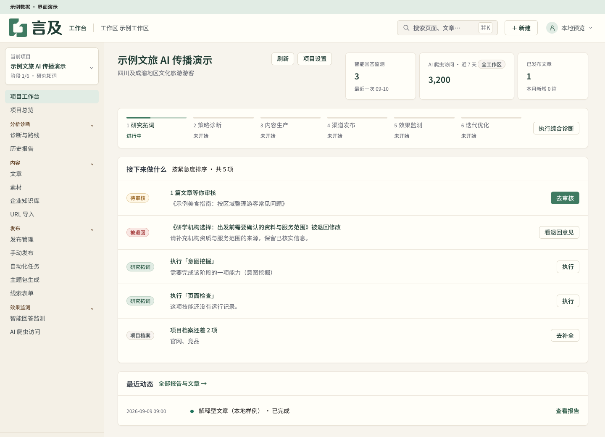

# 言及 Yanji GEO-SaaS — 开源自部署 GEO（生成式引擎优化）项目工作台

**简体中文** | [English](README.en.md) · 最新正式版：[v0.1.0](https://github.com/Mellowing-Potato/Potato-GEO-SaaS/releases/tag/v0.1.0) · 许可：[Apache-2.0](LICENSE) · [免 Docker 便携版](PORTABLE.md) · [Docker 部署](INSTALL.md) · [常见问题 FAQ](#常见问题-faq)

> **目标版本 `v0.1.1` 正在准备发行，尚未发布。** 本机免登录与网页连接 Magpie 的变更及本轮验收边界见 [更新日志](CHANGELOG.md)。下方一行安装命令目前仍指向已发布的 `v0.1.0`。

**言及（Yanji GEO-SaaS）** 是一款可自部署的开源 **GEO（Generative Engine Optimization，生成式引擎优化 / AI 搜索优化）项目管理与内容交付工作台**，面向 GEO 代运营个人、小团队与品牌市场人员。支持 **macOS Apple Silicon / Windows x64 / Linux 免 Docker 一键运行** 与 **Docker 自部署**，自带模型 Key（BYOK）、无订阅抽成，在独立隔离工作区中串联客户资料、1024 维向量知识库、11 项 GEO 技能报告与内容生成、中文平台草稿助手以及豆包 AI 搜索可见性监测。

> **目录**：[核心能力与六阶段工作流](#核心能力与六阶段工作流) · [快速安装（v0.1.0）](#快速安装v010) · [三分钟上手流程](#三分钟上手流程) · [界面预览](#界面预览) · [能力与边界](#能力与边界) · [言及与 GEOFlow 的区别](#言及与-geoflow-的区别) · [渠道支持](#渠道支持) · [常见问题 FAQ](#常见问题-faq) · [已验证与待验证](#已验证与待验证) · [许可与来源](#许可来源与品牌)

---

## 核心能力与六阶段工作流

传统 SEO 工具主要面向搜索引擎关键词排名，而言及聚焦 **AI 大模型搜索（生成式引擎优化 / AI SEO / LLM Visibility）** 的客户项目交付全流程：

- **免 Docker 便携运行 + Docker 自部署双形态**：`v0.1.0` 提供免 Docker 便携包（内置自建无 AGPL 的 FrankenPHP + PHP 8.5.13 + Python 3.12.16 + 开源中文字体），一条命令即可在 macOS Apple Silicon、Windows 10/11 x64 或 Linux 本机启动；同时完整保留 Docker Compose 部署方案。
- **自带模型 Key（BYOK）与可选本机 Magpie**：文本、视觉、1024 维向量与豆包联网搜索监测分别配置、加密存储；不内置代理加价、无充值或订购功能。结果未知的请求绝不自动重发，防止重复产生模型费用。
- **多客户项目管理与严格工作区隔离**：每个账号拥有独立工作区，可在工作区内管理多个品牌或客户项目；平台管理员无法查看其他用户工作区数据，私有报告默认具备静态 404 防护。
- **内置 11 项 GEO 技能与多格式报告渲染**：接入锁定版本的 [yao-geo-skills](https://github.com/yaojingang/yao-geo-skills)，覆盖意图挖掘、全景诊断、路线图、内容生成与标题优化，开箱支持 Markdown / HTML / DOCX 渲染（含字体子集化及部分技能的 ReportLab PDF 导出）。
- **豆包 AI 搜索可见性监测**：通过工作区配置的火山方舟联网搜索模型记录 AI 真实回答、搜索词、检索参考与模型用量，并支持导出报告。

### 六阶段 GEO 项目工作流与随包渲染技能

| 阶段 | 核心工作 | 对应功能 / 随包验证的 GEO 技能 |
| --- | --- | --- |
| 1. 研究拓词 | 梳理品牌资料、挖掘 AI 搜索用户提问意图 | 品牌材料与 1024 维向量知识库、`yao-geo-intent-miner`（意图挖掘） |
| 2. 策略诊断 | 评估品牌在生成式搜索中的现状并制定执行计划 | `yao-geo-panorama-audit`（全景诊断）、`yao-geo-execution-roadmap`（执行路线图）、`yao-geo-tracking`（追踪方案） |
| 3. 内容生产 | 生成并翻新适配 AI 检索引用的结构化内容与报告 | `yao-geo-explainer-builder`（科普解释文）、`yao-geo-ranking-article-builder`（榜单排名文）、`yao-geo-content-refiner`（内容翻新）、`yao-geo-title-optimizer`（标题优化）、`yao-geo-page-blueprint`（页面蓝图）、`yao-geo-brand-graph`（品牌图谱）、`yao-geo-knowledge-base-builder`（知识库构建） |
| 4. 渠道发布 | 区分编辑稿、平台草稿与真实公开链接，防止误登记 | 专属实例浏览器草稿助手（知乎纯文本草稿已实测）、发布单与人工发布记录 |
| 5. 效果监测 | 追踪豆包联网搜索回答、检索参考来源与调用用量 | 火山方舟豆包联网搜索监测、用量/耗时/成功与未知状态台账 |
| 6. 迭代优化 | 基于监测反馈与失败记录持续优化内容与知识材料 | 失败产物保留复核、内容翻新迭代与任务恢复 |

### 适用人群与场景

- **GEO 代运营个人与小团队**：按客户项目隔离资料、技能执行、交付报告、发布记录与监测台账。
- **品牌市场与内容团队**：自建私有 AI 搜索优化工作台，将品牌知识材料与内容生产留在自有设备或服务器。
- **重视数据隐私与可控成本的团队**：自带模型 Key（BYOK），无第三方 SaaS 订阅锁定，全量 Apache-2.0 开源可审计。

---

## 快速安装（v0.1.0）

**v0.1.0 已正式发布**：查看全部平台安装包、校验清单、对应源码与多架构 Docker 镜像请访问 [GitHub Release v0.1.0](https://github.com/Mellowing-Potato/Potato-GEO-SaaS/releases/tag/v0.1.0)，版本变更见 [更新日志](CHANGELOG.md)。

### 方式一：免 Docker 一键便携安装（推荐，开箱即用）

无需提前安装 Docker、PHP 或 Python。引导脚本仅允许 HTTPS，自动校验固定摘要的 `SHA256SUMS`（`5cc6eda319766dbc050869ac4c84b50f590947ca8fe66b390297d803b3efc570`）及包内全部文件哈希，并提供 `yanji` / `yanji.cmd` 管理命令（启动、停止、状态、体检 `doctor`、备份、恢复、升级）。

**macOS（Apple Silicon M1–M4）与 Linux（x86_64 / ARM64）：**

```sh
curl -fsSL https://github.com/Mellowing-Potato/Potato-GEO-SaaS/releases/download/v0.1.0/get-yanji.sh | sh
```

**Windows 10 / 11（64 位 PowerShell 5.1+）：**

```powershell
irm https://github.com/Mellowing-Potato/Potato-GEO-SaaS/releases/download/v0.1.0/get-yanji.ps1 | iex
```

> 首次安装需下载约 170–220 MB 便携运行时并进行完整校验，视网络速度可能需要 1–3 分钟后才会提示输入管理员邮箱与密码；已知 `v0.1.0` 发布资产在下载与校验阶段不会输出进度，请耐心等待（后续版本源码已补充实时进度提示）。离线安装、可审计两步安装、macOS 手动浏览器下载解除隔离属性及日常运维命令详见 [PORTABLE.md](PORTABLE.md)。Intel Mac（`macos-x64`）不含在便携包内，请使用下方 Docker 方式。

> **目标 `v0.1.1` 的便携流程（发行准备，未发布）**：全新便携实例默认无需填写邮箱和密码，由本机启动器授权打开工作台；`yanji open` 可再次打开。已有账号实例或显式账号模式保留原登录方式。维护者已确认 Mac 候选包的安装、更新、免登录工作台和本机 Magpie 服务检测与目录读取；Magpie 模型激活与真实推理未跑，详见 [PORTABLE.md](PORTABLE.md)。本文 `v0.1.0` 发布资产仍使用邮箱密码。

### 方式二：Docker 自部署

适用于服务器部署、PostgreSQL / pgvector 生产环境或 Intel Mac。先安装并启动 Docker，再克隆仓库并进入项目目录运行：

```bash
git clone https://github.com/Mellowing-Potato/Potato-GEO-SaaS.git yanji
cd yanji
bash scripts/install.sh
```

脚本会交互创建首个管理员并启动 `web`、`worker`、`scheduler` 与 `postgres` 四个容器服务。多架构镜像（`linux/amd64` + `linux/arm64`）与备份、恢复、升级、代理 DNS 排障详见 [INSTALL.md](INSTALL.md) 与 [v0.1.0 Release](https://github.com/Mellowing-Potato/Potato-GEO-SaaS/releases/tag/v0.1.0)。

### 方式三：交给 AI 编程助手自动安装

可以直接复制下面这句话发给你的 AI 编程助手（支持按需选择免 Docker 便携版或 Docker 版）：

```text
帮我按 PORTABLE.md（免 Docker）或 INSTALL.md（Docker）安装言及。仓库地址是 https://github.com/Mellowing-Potato/Potato-GEO-SaaS
```

---

## 三分钟上手流程

安装完成后打开终端打印的本机地址（Docker 默认 `http://localhost:8000`，便携版为 `http://127.0.0.1:<端口>`），用初始化时设置的管理员邮箱和密码登录：

1. **配置文本模型（必填）**：进入「模型配置」，选择直连并填写兼容供应商的模型名、Base URL 与 API Key，点击「测试连接」通过后保存；也可选择同机开源工具 [Magpie](https://github.com/yetone/magpie)（支持文本与视觉分别配置，原直连配置会保留随时可切回，详见 [Magpie 工作区授权说明](INSTALL.md#可选的-magpie-工作区授权)）。
2. **按需配置向量、视觉与监测模型**：
   - 使用知识库检索时，另配支持 **1024 维**的向量模型；
   - 需要识别图片或扫描件时，配置可选视觉模型；
   - 使用豆包 AI 搜索可见性监测时，另配火山方舟模型与 Key，并确认已在控制台开通该模型的联网搜索能力。
3. **建立项目并导入资料**：新建客户或品牌项目，通过文件、文本或 URL 导入品牌资料并入库知识库。
4. **运行 GEO 技能并审校交付**：在工作台六阶段中选择技能（如意图挖掘、全景诊断、标题优化、内容生成等）运行，人工审校后下载 Markdown / HTML / DOCX / PDF 报告，或配合浏览器助手同步平台草稿并登记真实公开链接。
5. **运行豆包监测并持续迭代**：发起豆包联网搜索监测，核对 AI 回答、搜索词与检索参考来源，依据反馈进入下一轮内容优化。

模型调用与联网搜索费用由你选择的供应商直接收取，言及不维护价格表、不代付费用，也没有充值和订购功能。Key 加密保存于各自工作区；未配置对应模型时会明确提示，不返回模拟结果。

---

## 界面预览

以下截图使用示例项目数据展示工作台与豆包监测界面位置（非真实客户数据或付费推理验收凭证）：



<details>
<summary>展开查看豆包 AI 搜索可见性监测示例截图</summary>


</details>

---

## 能力与边界

| 功能模块 | 当前能力与边界 |
| --- | --- |
| 项目与材料管理 | 按客户/品牌项目管理资料、知识材料、文章、历史版本和素材 |
| GEO 技能与报告 | 意图研究、全景诊断、路线图规划及内容辅助生成；支持多格式报告下载，生成物需人工审核 |
| 1024 维向量知识库 | 材料入库、1024 维向量化与检索；未配置向量模型时不能入库 |
| 豆包 AI 搜索监测 | 直接调用火山方舟联网搜索，展示回答与上游返回的检索参考；参考来源不一定在正文逐条引用 |
| 渠道发布管理 | 严格区分编辑稿、平台草稿和真实公开链接；未取得真实公开链接不登记为“已发布” |
| 用量与任务容错 | 记录调用次数、tokens、耗时及成功/失败/结果未知状态；已发出但结果未知时不自动重发 |
| 分析、线索与主题包 | 保留分析面板、线索表单、主题包生成及队列健康入口；需配合相应项目数据或配置使用 |

- **工作区隔离**：每个账号对应一个独立工作区。你可以在自己的工作区管理多个客户项目，也可开启注册让客户各自建号。**代运营者和平台管理员均不能查看其他用户工作区里的内容；不提供多人共享工作区。** 首个管理员也只操作自己的工作区。
- **向量模型一致性**：知识库按「供应商 + 模型名」识别向量模型。存在已入库材料时禁止切换模型（即使同为 1024 维也不能混用）。更换前需在知识库页面删除现有材料再重新导入；当前版本暂未提供一键清空。
- **质量校验与风险提示**：模型返回结果不保证满足质量要求。一次解释型长文实测未通过长度和研究依据检查，系统保留失败结果，没有记为可交付文章；标题优化实测完成并可下载 DOCX。系统内评分属于模型建议，不代表真实点击率、排名或营销效果。

---

## 言及与 GEOFlow 的区别

**来源致谢**：言及移植并改造了姚金刚老师的 [GEOFlow](https://github.com/yaojingang/GEOFlow) 部分功能与代码，并使用了 [yao-geo-skills](https://github.com/yaojingang/yao-geo-skills) 的技能、方法与报告资产。感谢姚金刚老师及上游贡献者。两个项目关注的使用场景不同，可按工作方式选择：

- **言及（Yanji GEO-SaaS）** 将**客户项目**作为工作主线：围绕研究、诊断、生产、发布、监测与迭代六阶段留存资料、技能报告、文章与发布记录，适合需要为多个客户或品牌分别交付 GEO 服务的个人与小团队（并提供免 Docker 便携版与 Apache-2.0 许可）。
- **GEOFlow** 更侧重**企业官网与多站点的持续内容运营**：将企业知识库、文章与专题生产、质量审核、多站点分发和运营分析放进同一套系统，适合需要建设官网、维护多个内容站点与组织多人审核工单的团队。

**对比基准：** 2026-11-14 的言及源码与 GEOFlow 3.2.1（固定提交 [`6976eec`](https://github.com/yaojingang/GEOFlow/tree/6976eec849cc8be7829f15723c600b111552d99c)），言及的 Magpie 接入与 `v0.1.0` 便携版状态更新至 2026-11-24。本表客观说明双方当前功能范围，不代表言及全部为原创新增。

| 对比项 | 言及（Yanji GEO-SaaS） | GEOFlow 3.2.1 |
| --- | --- | --- |
| 产品重点 | 客户项目、GEO 技能、报告与内容交付 | 企业官网、内容生产、多站点持续运营 |
| 工作组织 | 一个工作区管理多个客户项目，关联材料、技能执行、文章与分析 | 围绕站点、栏目、生产任务和企业知识组织，也有企业知识项目 |
| 工作流程 | 研究拓词、策略诊断、内容生产、渠道发布、效果监测、迭代优化六个阶段 | 知识导入、文章与专题生产、质量门禁、人工审核、站点分发与分析 |
| 账号与协作 | 一人一个独立工作区；平台管理员只能使用自己的工作区内容；没有多人共享工作区 | 普通管理员与超级管理员分工，支持运营审核、任务分派和人工发布工单 |
| 模型配置 | 文本和视觉可分别选择直连或同机 Magpie，向量和豆包监测独立配置，Key 按工作区加密保存 | 管理员个人模型优先，可绑定超级管理员共享模型；有模型归属及访问规则 |
| 材料导入与识别 | 支持文件、文本和 URL 导入，提供 PDF 文本层提取和可选视觉识别。Magpie 原生回环接入已实测合成扫描件识别 | 支持 TXT、Markdown、DOCX、PDF、PPTX 文本导入；扫描件和纯图片文档要求先做 OCR |
| 向量模型 | 固定 1024 维，按供应商和模型名判断身份；已有材料时禁止换模型，须先删除材料再导入 | 按供应商、模型、协议和维度校验兼容性，提供索引同步；缺少兼容向量模型时可回退关键词检索 |
| GEO 技能 | 将锁定版本的 yao-geo-skills 接入项目流程，适配提示词、报告渲染、输出校验和字体 | 提供文章、专题等生产流程，另有面向开发和运营自动化的 Agent Skill 入口 |
| 报告与内容交付 | 技能结果关联客户项目，支持报告下载；标题优化及 DOCX 下载已实测 | 重点是文章、专题、审核记录和站点内容交付，也有导出与运营分析 |
| 内容质量检查 | 校验技能输出与交付结果；未通过质量要求时保留失败结果，不记为可交付内容 | 检查知识证据、数据与引文、广告规则等，支持评分、自动优化和人工审核 |
| 官网与多站点 | 保留主题包、网站渠道等模块；当前交付重点是项目工作台，完整多站点流程未验收 | 企业官网、托管站点、目标站点 Agent、模板、栏目、专题及 sitemap、llms.txt 等是核心能力 |
| 持续内容运营 | 主要按项目运行技能、管理文章，当前交付范围未包含专题周期维护和链接池推荐投放 | 有专题组文与维护、链接池、推荐投放和图片库智能配图 |
| 浏览器辅助发布 | 知乎“文章”纯文本草稿同步已实测；微博“文章”有保存草稿实现和自动化测试，真实账号未验收 | 头条号、搜狐号、网易号通过人工工单辅助；知乎“回答”可核对账号并填入纯文本 |
| 助手连接方式 | 从自己的实例下载专属安装包，绑定具体协议、域名和端口，校验工作区、账号与任务版本 | 使用设备配对码和最小权限 Token；一个 Chrome 用户资料连接一个 GEOFlow 实例 |
| 网站与其他渠道 | 有 WordPress、HTTP 接口及公众号排版、草稿代码；这些真实远端流程尚未完成验收 | 提供 WordPress REST、通用 HTTP、托管站点和 GEOFlow Agent 等分发方式 |
| 豆包与 AI 可见性 | 通过工作区配置调用火山方舟联网搜索；真实回答、参考来源和报告导出已验收 | 同样支持火山方舟联网搜索，并提供关键词采样、专题、竞品、信源、词云和访问/爬虫分析 |
| 未知结果与恢复 | 模型结果未知时不自动重发，保留任务和结果状态；单次请求的故障场景已验收 | 有工作流恢复、回执核对和未知结果处理；部分明确技术错误按规则有限重试 |
| 分析、线索与主题包 | 保留并适配了上游相关组件，按项目使用 | 属于原有功能体系，并继续围绕站点运营扩展 |
| 安装与升级 | 免 Docker 四平台便携一键安装（内置 SQLite/Python/字体）与 Docker Compose 双模式，支持备份、恢复与升级 | 有开发与生产 Compose、独立 Updater 的签名更新和恢复点，以及 CLI、API、Agent Skill |
| 默认运行组件 | 便携版：自建 FrankenPHP + PHP CLI + SQLite；Docker 版：web、worker、scheduler、PostgreSQL，无需 Redis | 生产使用 Nginx、PHP-FPM、PostgreSQL、Redis 及多个运行进程和队列 |
| 界面与语言 | 中文项目工作台，模型配置窄屏表单已实测 | Admin UI V3 提供六种语言、响应式布局、PWA 和图文帮助 |
| 许可 | 项目代码 Apache-2.0；所移植的历史 GEOFlow 版本为 Apache-2.0，技能资产为 MIT | 当前 3.2.1 仓库使用 AGPL-3.0；历史版本按当时许可判断 |

双方都支持自带模型 Key、知识库检索、内容质量检查、浏览器辅助发布和豆包监测，也都有未知结果处理机制。文件级移植来源见 [移植清单](licenses/ported-files.json) 和 [NOTICE](NOTICE)。两边的浏览器助手都由用户完成最终公开发布，平台密码和 Cookie 留在本机浏览器。

上游一列依据固定版本的[项目说明](https://github.com/yaojingang/GEOFlow/blob/6976eec849cc8be7829f15723c600b111552d99c/README.md)、[模型权限说明](https://github.com/yaojingang/GEOFlow/blob/6976eec849cc8be7829f15723c600b111552d99c/docs/admin-ai-config-sharing-runbook.md)、[知识导入说明](https://github.com/yaojingang/GEOFlow/blob/6976eec849cc8be7829f15723c600b111552d99c/docs/knowledge-import.md)、[浏览器助手说明](https://github.com/yaojingang/GEOFlow/blob/6976eec849cc8be7829f15723c600b111552d99c/browser-extension/README.md)、[工作流恢复说明](https://github.com/yaojingang/GEOFlow/blob/6976eec849cc8be7829f15723c600b111552d99c/docs/operations/article-workflow-recovery.md)及相关源码核对，未在本次对比中运行验收；未做双方性能、生成质量或 GEO 效果的对比测试。

---

## 渠道支持

| 渠道 | 实现与验证范围 |
| --- | --- |
| 知乎文章 | 自定义实例域名的浏览器助手已实测纯文本草稿同步；公开发布由你完成 |
| 微博文章 | 已有无图文章草稿适配与自动化测试；本次自部署验收未连接真实账号，图片转存未验收 |
| WordPress、HTTP 接收端 | 已有网站渠道接口；需配置目标站点和凭据，本次未做真实远端发布验收 |
| 微信公众号 | 已有排版导出和草稿接口代码；真实连接及远端草稿验收暂缓 |
| 小红书及其他登记平台 | 管理账号、发布单和人工发布记录，不代表支持自动发布 |

浏览器助手从你自己的实例下载，仅信任配置的实例地址。它保存草稿，不替你公开发布。详见 [助手说明](browser-extension/README.md)。

---

## 常见问题 FAQ

### 1. 言及是免费开源的吗？有没有付费订阅或按量加价？
是的，言及项目代码采用 [Apache-2.0](LICENSE) 开源许可，可自由自部署。系统本身不含充值、订购或中心化模型网关；你直接在工作区填入自己选择的模型供应商 API Key（BYOK），模型调用与联网搜索费用由对应供应商收取。

### 2. 使用言及必须安装 Docker 吗？支持哪些操作系统？
不需要必须安装 Docker。自 `v0.1.0` 起，言及提供免 Docker 便携安装包，支持 **macOS Apple Silicon（M1–M4）**、**Windows 10/11 x64**、**Linux x86_64** 与 **Linux ARM64**，内置独立 PHP、FrankenPHP、Python 3.12.16 与开源字体，一条命令即可安装启动。如果你使用 **Intel Mac** 或偏爱容器化与 PostgreSQL/pgvector，可继续使用 Docker 部署。

### 3. 支持哪些 AI 模型与 AI 搜索监测平台？
文本、视觉与 1024 维向量模型均支持自由配置兼容接口的供应商直连；文本和视觉还可选接同机运行的开源工具 [Magpie](https://github.com/yetone/magpie)。AI 搜索可见性监测目前通过火山方舟联网搜索能力支持**豆包监测**（需在火山方舟开通对应模型及 `web_search` 能力）。

### 4. 给多个客户做 GEO 代运营时，数据会互相串库吗？
不会。一个账号对应一个独立工作区，可在其中按项目管理不同客户；不同账号工作区之间数据、知识库、模型 Key 与私有报告严格隔离，连平台管理员也无法查看其他用户工作区的内容，且私有报告路径具备静态 404 防护。

### 5. 浏览器助手为什么只保存草稿，不自动一键公开发布？
为了保护账号安全与内容质量：平台登录态与 Cookie 始终留在你的本机浏览器，助手只负责把审核过的稿件同步为平台草稿，由你确认后完成最终公开发布；系统在未取得真实公开链接前绝不把草稿登记为“已发布”。

### 6. 为什么言及与传统 SEO 工具不同？
传统 SEO 工具聚焦网页外链、关键词密度与经典搜索引擎排名；GEO（生成式引擎优化）关注品牌事实、结构化知识与可信引文如何被大模型检索、理解与引用。言及把 GEO 拆解为意图挖掘、全景诊断、结构化内容生产、草稿发布、豆包联网搜索可见性监测与迭代复盘六阶段，帮助团队沉淀可复用的客户项目交付资产。

---

## 已验证与待验证

- **v0.1.1 发行准备（尚未发布）：** 维护者已在 Apple Silicon Mac 候选包上确认安装、更新、免登录进入工作台，以及网页检测本机 Magpie 服务和读取模型目录。当前来源截图仍为第三方直连，不能据此认定 Magpie 已激活或实际推理通过。`v0.1.1` 正式发行 CI、其他平台本轮发行验收和新增网页连接后的真实推理未跑；以下 `v0.1.0` 平台结果为历史验证。
- **自动化测试与 v0.1.0 发布流水线：** SQLite、PostgreSQL、前端、字体与技能快照均具备自动化测试（本地运行见 [贡献指南](CONTRIBUTING.md)）。`v0.1.0` 正式发布流（[#45369285542](https://github.com/Mellowing-Potato/Potato-GEO-SaaS/actions/runs/45369285542)）全部 8 项任务通过，已公开 [GitHub Release v0.1.0](https://github.com/Mellowing-Potato/Potato-GEO-SaaS/releases/tag/v0.1.0)（17 项资产）与双架构 Docker 镜像。自动化测试通过不等于全部真实第三方平台账号均已验收。
- **界面实测：** 新安装、登录与退出、三种真实模型连接、材料入库和检索、豆包监测、标题内容生成、报告下载、用量、未知结果不自动重发、窄屏模型表单。
- **Magpie 实测：** 原生回环接入已实测文本请求、队列生成结构化标题报告和合成扫描件识别。
- **四平台免 Docker 便携版验收（v0.1.0）：**
  - **macOS Apple Silicon (`macos-arm64`)**：本地实机与 `macos-15` 发布流全链路验收均已通过（无宿主机 Python 冷安装、`doctor`、私有静态 404 护栏、501 作业轮换、2 秒超时接替、优雅停止排空、备份恢复、同实例重装与共享缓存复用、缓存与清单编码篡改拒绝、11 技能渲染、真实浏览器登录/工作台/模型配置/建项）。
  - **Windows x64 (`windows-x86_64`)**：原生 `windows-2025` 发布流全链路构建与验收通过（无 Mercure/Vulcain FrankenPHP + Brotli 1.2.1 + PHP 8.5.13 ZTS + 随包 Python 3.12.16 + 字体、11 技能渲染、中文空格路径冷安装、`yanji.cmd` 帮助与 `doctor`、私有静态 404、501 作业轮换、2 秒超时接替、优雅停止、备份恢复、重装/缓存复用与篡改拒绝）。
  - **Linux (`linux-x86_64` / `linux-aarch64`)**：原生 `ubuntu-24.04`（x86_64）与 `ubuntu-24.04-arm`（ARM64）在 `v0.1.0` 发布流中均已通过 11 技能渲染与完整便携冷安装、404、超时、轮换、排空、恢复与篡改拒绝验收；arm64 亦在原架构 VM 实测通过。Intel Mac (`macos-x64`) 不纳入便携包范围。
- **Docker 平台：** Apple 芯片 Mac / Linux arm64 容器及独立冷安装回归已验证；Linux amd64 与 arm64 双架构 CI 测试及镜像构建推送已通过，Linux amd64 Docker 的完整手工业务流程仍待实测。
- **未验证与本版不含：** Windows 本机桌面浏览器手工点击验收、Magpie 容器接入的真实 Gateway Key 鉴权和推理、其他视觉模型、渠道表中注明未验收的真实外部账号发布、Apple Developer ID 公证与 Windows EV 代码签名。旧版工作台预览入口默认关闭。

---

## 许可、来源与品牌

言及项目代码采用 [Apache-2.0](LICENSE)。第三方代码、依赖、字体和技能保留各自许可；见 [NOTICE](NOTICE) 与 [第三方声明](THIRD_PARTY_NOTICES.md)。便携版各平台 CLI / Web 运行时的对应源码与重链接材料均随 [GitHub Release](https://github.com/Mellowing-Potato/Potato-GEO-SaaS/releases/tag/v0.1.0) 一同公开分发。

GEOFlow 移植来源包括早期提交 `7a8f6ff2643222cadbfb9b2bbb4252284df6ea72` 和 v2.3.0（`97119662325b1d6d88ff6a3f390567bcfa91eedd`），这些历史版本为 Apache-2.0。技能资产锁定 `136eb92c90946ea56ec63f912d5025bcbc884f39`，使用 MIT。未来引入上游更新时必须重新核对其许可。

Apache-2.0 不授予商标权。二次部署的运营者不得以“言及官方”身份对外，不能暗示获得原作者或维护者背书。运营者自行承担用户协议、隐私政策和当地合规义务，并负责自己的实例和数据安全。

---

## 参与与支持

- 缺陷反馈与功能建议：[GitHub Issues](https://github.com/Mellowing-Potato/Potato-GEO-SaaS/issues)
- 贡献代码与本地测试：[贡献指南](CONTRIBUTING.md)
- 安全漏洞私密上报：[安全政策](SECURITY.md)
- 版本历史与演进规划：[更新日志](CHANGELOG.md) · [路线图](docs/roadmap.md)

未交付功能不作可用承诺。
